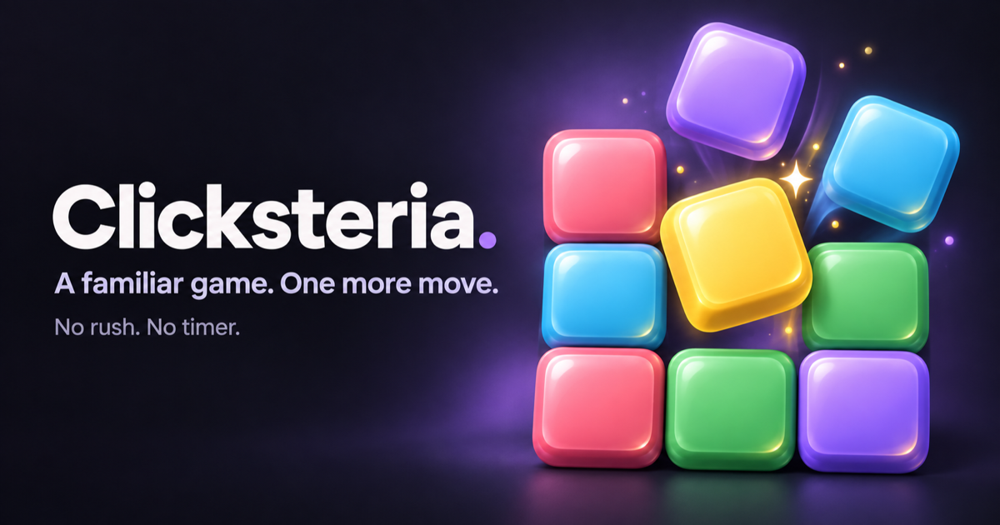

# Clicksteria



A colorful block-matching puzzle game built with Angular 22 and plain CSS, with a dark sunset-and-indigo design inspired by the native iOS app. English interface, responsive layout, SSR/prerendering, lazy routes, and no backend or external runtime services.

## Development

Use pnpm 12.4.1 (pinned in `package.json`) with Node.js 24. If using Corepack, enable it with `corepack enable pnpm`.

```sh
pnpm install --frozen-lockfile
pnpm start
pnpm test --watch=false
pnpm build
```

Open http://localhost:4200. Production output is in `dist/clicksteria`; `pnpm serve:ssr:clicksteria` runs the generated server. Global design tokens, shared controls, and the browser reset live in `src/styles.css`; individual components use adjacent CSS files. No CSS framework or custom PostCSS configuration is needed.

Installing dependencies also activates the Husky pre-commit hook. It runs ESLint, Prettier, and Stylelint only on the relevant staged files, keeping commits fast while preventing new lint and formatting issues.

Run `pnpm lint` to check TypeScript, templates, and CSS, or `pnpm lint:fix` to apply automatic fixes. For CSS alone, use `pnpm lint:css` and `pnpm lint:css:fix`. CSS formatting runs Prettier first to collapse extra blank lines, then Stylelint to require a blank line between rule blocks and before at-rules, including inside `@media`, `@layer`, and `@keyframes`. The first block inside a container has no leading blank line, and comments stay with the block they describe. These same CSS fixes run automatically before commits.

## Architecture

```text
src/
  main.ts               Browser bootstrap
  main.server.ts        Angular server bootstrap
  server.ts             Express SSR server entry point
  app/
    app.routes.ts       Top-level lazy routes and route SEO data
    app.routes.server.ts
                        Prerender policy for every route
    core/
      audio/            Sound preference and lazy Web Audio playback
      services/         SEO metadata and record persistence
    layout/             Persistent shell, navigation, route focus
    shared/ui/          Reusable icons and preference controls
    features/
      game/
        domain/         Immutable models and pure TypeScript rules
        data-access/    Signal store, saved sessions, history, preview, record
        ui/             Accessible board and presentational sidebar
        pages/          Feature composition and browser initialization
        game.routes.ts  Lazy game route and SEO metadata
      rules/            Lazy rules page
      settings/         Lazy appearance settings page
      not-found/        Lazy wildcard page
```

The router lazy-loads the game route collection and the standalone rules, settings, and not-found pages. `AppShell` stays mounted around them, owns global navigation and focus restoration, and starts route-driven SEO updates. Angular prerenders all routes on the server, then hydrates them in the browser.

Inside the game feature, dependencies flow from page/UI → `GameStore` → domain engine. The domain imports no Angular APIs, keeps board transformations immutable, and accepts an injectable random function for deterministic tests. The board receives state and emits user intents; it does not own scoring, history, persistence, or sound. The sidebar is presentational.

`GameStore` is a root singleton, so the current session and undo history survive navigation between Play, Rules, and Settings. It coordinates domain operations with the app-wide record and sound services and saves the current session in browser storage. Browser-only initialization restores an unfinished saved session or creates a fresh game in `afterNextRender`, avoiding SSR and hydration mismatches. Sessions, sound, board appearance, and record preferences remain usable in memory when browser storage is unavailable.

New routes belong in `app.routes.ts` and should be lazy by default. Keep game-specific state and behavior under `features/game`; put truly app-wide browser concerns in `core`; keep `shared/ui` limited to reusable presentational controls.

Components use Angular 22's default change detection, standalone defaults, signal inputs/outputs, and native control flow. TypeScript and Angular template strictness are enabled. Page layouts and chrome use plain CSS with custom properties, Grid, Flexbox, logical properties, fluid sizing, and features available across Baseline 2024 browsers. Component templates and CSS are kept in adjacent files. Shared focus and reduced-motion rules live in the global stylesheet.

The board draws tiles and optional shape symbols on a single 2D canvas above the optimized background image. `game-board-renderer.ts` owns pixel-aligned drawing; `game-board-canvas.ts` owns device-pixel-ratio scaling, resizing, and animation scheduling. Classic jelly artwork and landing poses are cached as sprites in `game-board-jelly.ts`; `game-board-motion.ts` handles accelerating falls, soft landings, and removed blocks flying down off the field. Minimalist keeps its 180 ms falling animation; ZX Spectrum adds flat bright blocks with 8 × 8 pixel symbols. Frames are requested only for changes and while tiles are moving. Pointer hit testing follows surviving tiles' visible positions during a fall; departing blocks cannot be played again. Browser observers, media-query listeners, and pending frames are released when the board is destroyed.

### Import aliases

Aliases are defined once in the root `tsconfig.json` and inherited by the application and test configurations. Angular's build and test tooling resolves them for browser bundles, SSR, and lazy routes.

| Alias         | Directory                                                |
| ------------- | -------------------------------------------------------- |
| `@app/*`      | `src/app/*` (root components, configuration, and routes) |
| `@core/*`     | `src/app/core/*`                                         |
| `@shared/*`   | `src/app/shared/*`                                       |
| `@layout/*`   | `src/app/layout/*`                                       |
| `@features/*` | `src/app/features/*`                                     |

Use the most specific alias for imports between directories, including dynamic imports. Keep relative imports for neighboring files in the same directory, such as a test importing its subject. Import directly from the source file rather than introducing barrel files; aliases do not change the dependency direction described above.

```ts
import { SoundService } from '@core/audio/sound.service';
import { GameStore } from '@features/game/data-access/game-store';
import { Icon } from '@shared/ui/icon';
import { GameBoard } from './game-board';

const loadGameRoutes = () => import('@features/game/game.routes');
```

Path targets are relative to `tsconfig.json`, so no `baseUrl` is needed. Component template/style URLs and public asset URLs remain relative paths or web URLs; these aliases apply only to TypeScript module imports.

## Game rules

- 10 columns × 15 rows, five colors; every initial board has at least one legal move.
- Click any orthogonally connected group of at least two matching tiles.
- Remaining tiles fall down; empty columns collapse left.
- A group of `n` tiles awards `n × (n − 1)` points. Clearing the board adds 1,000.
- No remaining groups ends the game; an empty board is a win.
- Undo restores the exact prior board and score, up to the start of the current game. It remains available after a win or loss in the current tab, until you reload.
- Hint highlights the largest current group, with no penalty; it does not guarantee a solution.
- A new game asks for confirmation if moves have been made and the game is still active.

The record is the highest score reached, including before undo. It persists separately in localStorage under `clicksteria:classic:best:v1`; appearance and sound preferences keep their existing separate keys.

**Games played** counts games started, including the first game, a confirmed new game, Play again, and the fresh game created when reopening a finished game. Restoring an unfinished game, Undo, Hint, and navigation do not increase it. The count persists separately under `clicksteria:games-started:v1`, stays local to this browser, and remains usable in memory if storage is blocked. An existing unfinished save initializes an otherwise empty counter to 1; games played before this counter was introduced cannot be reconstructed.

The current game autosaves as one version 1 snapshot under `clicksteria:classic:session:v1`. It includes the current board's tile IDs and colors, score, move count, and full Undo history. A new game, each successful move, and Undo save immediately. Opening `/play` restores an unfinished saved game automatically after hydration, including after a reload or browser restart. Starting a new game replaces the saved snapshot.

A finished game is not resumed: reloading or reopening after a win or loss creates a fresh 150-block board with zero score and an empty Undo history. The best score remains saved separately. Undo is still available after the game ends in the current tab; using it before reloading returns the game to an unfinished state, which is saved and can resume again.

Invalid or unsupported snapshots are ignored and a fresh game is created. If storage cannot be read or written, the game remains playable in memory, but unsaved changes may not survive a reload. Random board creation and storage reads run in `afterNextRender`, avoiding server/client hydration differences. Saved games stay in this browser; there is no server copy, cloud sync, or account backup.

`GameSessionStorage` isolates browser storage and writes each complete snapshot with one `setItem`. The pure `domain/game-session.ts` decoder validates the version, board dimensions, unique tile IDs, colors, scores, and full history by replaying each transition through the game engine. This keeps malformed saves from entering the store or breaking Undo.

Game progress does not synchronize live across tabs. Each open tab keeps its own in-memory game. Reloading uses the last successful save from any tab: an unfinished game resumes, while a finished game starts a fresh board. This does not change the existing cross-tab synchronization of appearance and sound preferences.

## Accessibility and verification

All three block styles show distinct shape symbols by default. The shared **Show block symbols** switch can hide them in every style; leave it enabled for visual cues beyond color. Descriptive accessible names remain available with symbols on or off. Tab enters/leaves the board; arrow keys move between tiles; Home/End move to the first/last column; Enter/Space plays. A single focusable ARIA grid exposes the current tile through an active descendant, keeping DOM size constant as the board changes. Focus stays on the board after removal, and moves are announced through a live region. Reduced-motion preferences disable falling, jelly landing, and removal animations, including when changed during play.

Unit coverage includes branching adjacency, diagonal exclusion, invalid moves, gravity, empty-column collapse, immutable snapshots, scoring, wins, blocked boards, seeded complete games, undo, hints, session restoration, malformed saves, and unavailable browser storage.

## Appearance

Open **Settings** from the header to choose the block style, board scenery, symbol visibility, and highlight dimming at `/settings`. Returning to Play keeps the current board, score, and undo history.

The website uses a single dark appearance: an atmospheric sunset backdrop, translucent indigo panels, light text, and cyan-to-violet action buttons. Browser controls, browser chrome, and the installed PWA start dark before Angular loads. There is no theme picker, system-theme listener, or pre-paint storage script; old theme preferences are ignored.

`src/styles.css` owns the shared color tokens, reset, buttons, surfaces, focus cues, and reduced-motion behavior. Layout and component CSS use the same palette across Play, Settings, Rules, and the legal pages. Game blocks use the selected Classic, Minimalist, or ZX Spectrum artwork; the retro choice changes the blocks and their sounds while preserving the surrounding interface.

The CSS uses native cascade layers, custom properties, logical properties, responsive Grid/Flex layouts, `clamp()`, small viewport units, and localized backdrop filtering within the Baseline 2024 feature set. The emblem and menu sunset in `public/images/branding/` are copied from the native iOS asset catalog. Play puts the selected scenery behind the whole interface; other pages share the menu sunset. The board remains a transparent canvas over that backdrop.

### Block styles

The **Block style** controls in Settings offer three appearances:

- **Classic** (default): rounded jelly blocks based on the native iOS field, with glossy highlights, soft shadows, and optional shape symbols. Removed blocks fly down off the field; surviving blocks stretch slightly as they fall and wobble gently on landing.
- **Minimalist**: simple opaque, beveled blocks sharing Classic's base colors and light shape symbols, with their existing 180 ms falling animation.
- **ZX Spectrum**: angular pixel blocks in five bright colors—red, yellow, cyan, magenta, and green—with optional black 8 × 8 pixel symbols and mono 48K beeper-style sounds. The block artwork has no gradients, glow, or jelly highlights. Its Settings preview uses a black plate.

All styles work with every board scenery against the dark interface. The selected style is applied when returning to Play without starting a new game or changing the board, score, or undo history. Classic and Minimalist keep their existing motion and sound behavior. Idle boards do not run an animation loop.

The preference persists under `clicksteria.block-style` and synchronizes across tabs. Choosing Classic removes the override; Minimalist uses `minimal` and ZX Spectrum uses `spectrum`. The retired Glass style falls back to Classic. Storage restrictions fall back to an in-memory choice. `features/game/domain/block-style.ts` defines the catalog, `data-access/block-style.service.ts` owns browser persistence, and `ui/block-style-picker/` owns the controls. Server and initial browser rendering start with Classic; a stored preference is restored after hydration.

**Show block symbols** is enabled by default and controls all three styles and their Settings previews. Shapes make colors easier to tell apart. Turning it off hides only the symbols, preserving each style's colors, lighting, and motion. `data-access/board-symbols.service.ts` saves an opt-out as `false` under `clicksteria.show-symbols`; enabling symbols removes the override. The choice restores after hydration, synchronizes across tabs, and stays usable in memory if storage is blocked. Changing it keeps the current board, score, and undo history.

**Dim other blocks** is enabled by default. It softens blocks outside the highlighted group when hovering, navigating with the keyboard, or using a hint. Turn it off to keep their usual brightness while preserving the highlighted group's outline. This setting works with every block style. `data-access/board-dimming.service.ts` saves an opt-out as `false` under `clicksteria.dim-others`; enabling it removes the override. The choice restores after hydration, synchronizes across tabs, and stays usable in memory if storage is blocked.

### Board scenery

The **Board scenery** selector in Settings defaults to **Auto**, using the player's local date and Northern Hemisphere seasons: winter (December–February), spring (March–May), summer (June–August), and autumn (September–November). Celebrations take priority over the season:

| Scenery           | Automatic dates (inclusive)                           |
| ----------------- | ----------------------------------------------------- |
| New Year          | December 27–January 7                                 |
| Valentine's Day   | February 12–15                                        |
| St. Patrick's Day | March 14–18                                           |
| April Fools' Day  | April 1                                               |
| Easter            | Friday–Monday around both Western and Orthodox Easter |
| Earth Day         | April 20–23                                           |
| Midsummer         | June 20–24                                            |
| Halloween         | October 24–November 2                                 |
| Christmas         | December 18–26                                        |

These are decorative windows rather than public-holiday definitions. Easter wins if its window overlaps Earth Day. All four seasons, nine celebrations, **Classic lake**, and **Sunset mountains** can also be selected manually without changing the board, score, history, or focus. A manual choice persists under `clicksteria.scenery` and synchronizes across tabs; returning to Auto removes the override. Storage failures keep the choice in memory.

`features/game/domain/board-scenery.ts` owns the pure calendar and catalog; `data-access/board-scenery.service.ts` owns browser initialization, persistence, and date refresh. SSR starts with the same classic lake on server and client; the local scenery is selected after hydration. Auto refreshes at local midnight and when the app regains visibility or window focus, including after sleep or a timezone change. No location permission, network calendar, or date library is needed.

The fifteen decorative backgrounds in `public/images/scenery/` are the native iOS artwork, copied as 1024 × 1536 JPEGs. Settings shows one large preview of the selected native scene, replacing its image when the selection changes; it does not decode the whole catalog. Matching 170 × 256 thumbnails are also bundled. The existing scenery IDs, saved choices, and Auto calendar are preserved; Sunset mountains is an additional manual choice. A dark overlay keeps the empty field calm. All block styles keep their opaque tiles and optional shape symbols over the scenery; selection outlines and pointer hit testing work in each style. Scenery adds no weather particles, flashing lights, or animation loops. The PWA's lazy asset cache stores each background and thumbnail when first used.

## Sound

Game actions (mouse, touch, or keyboard) select one of three sound banks. **Classic** plays native iOS bubbling effects (`bubble-*.wav`), **Minimalist** plays the original plain clicks/pops (`pop-*.wav` and `single-block.wav`), and **ZX Spectrum** plays locally generated mono 48K beeper-style effects (`spectrum-*.wav`). The twenty native 44.1 kHz mono PCM WAV files and ten generated Spectrum WAVs are bundled in `public/audio/`, for thirty files in total. There is no external music or remote sound service.

Each bank has three variations for small groups (2–4 blocks), medium groups (5–11), and large groups (12 or more), plus a quieter sound for tapping a single block. Variations avoid immediate repeats within each style and group size. The native banks keep their iOS gain levels: 0.34 for groups and 0.28 for single blocks. Changing the block style selects its sounds on the next action without resetting the board, score, or Undo history. Regenerate the Spectrum bank with `node scripts/generate-spectrum-sounds.mjs`.

The speaker button toggles game sounds; the preference is stored as `true` or `false` under `clicksteria.sound` and synchronizes across tabs. Sound is on by default. `core/audio/sound.service.ts` owns the preference, storage, sample loading, lazy Web Audio context, playback, and cleanup. The toggle only displays state and calls the service; `GameStore.play()` selects the sound style and effect from the current block style and actual move result. Sample bytes preload after browser rendering, while the audio context is created and resumed only for a user action. Decoded samples are cached, with bounded overlapping voices for quick moves. Muting stops active voices and cancels pending playback. Missing or blocked audio/storage never interrupts the game. The PWA's existing audio asset glob prefetches all three banks so all variations remain available offline after installation.

## PWA and updates

The service worker is enabled in production builds on HTTPS (or localhost). It registers after application stability, with a 30-second fallback. Test it with `pnpm build` and `NG_ALLOWED_HOSTS=localhost,127.0.0.1 pnpm serve:ssr:clicksteria`, not the default development server. The local production server listens on port 4000 unless `PORT` is set.

`core/pwa/app-update.service.ts` listens for `VERSION_READY` and displays an inline banner above the page only after the new version has downloaded. Checks run after stability, every six hours while visible and online, when returning to the app, and when connectivity returns. Failed checks are retried at the next trigger. An unrecoverable worker state displays a recovery prompt. Nothing reloads automatically: the button reloads the page to load matching shell and lazy bundles. An unfinished game resumes from the latest valid save with its Undo history after hydration; a finished game starts fresh. The stored best score and preferences remain. If saving is unavailable, unsaved progress may be lost on reload.

The server caches content-hashed JS/CSS for a year, but requires revalidation of worker scripts, `ngsw.json`, the web manifest, HTML, and unversioned assets. Preserve these headers at the CDN/reverse proxy; do not apply a cache-everything rule to these resources. Deploy each build atomically so the manifest and its referenced assets belong to the same release.

To verify an update, serve production build A, open `/play`, make a move without finishing the game, and wait for the service worker to control the page. Keep that tab open, replace the served build with build B containing a source change, and return to the tab (or reconnect). The banner should appear once B is downloaded; clicking **Refresh to update** loads B and resumes the unfinished saved board, score, moves, and Undo history. Also verify the same restoration during an offline reload after the initial cache is populated. Reloading a finished game should create a fresh 150-block board with zero score and no Undo, while keeping the best score.
