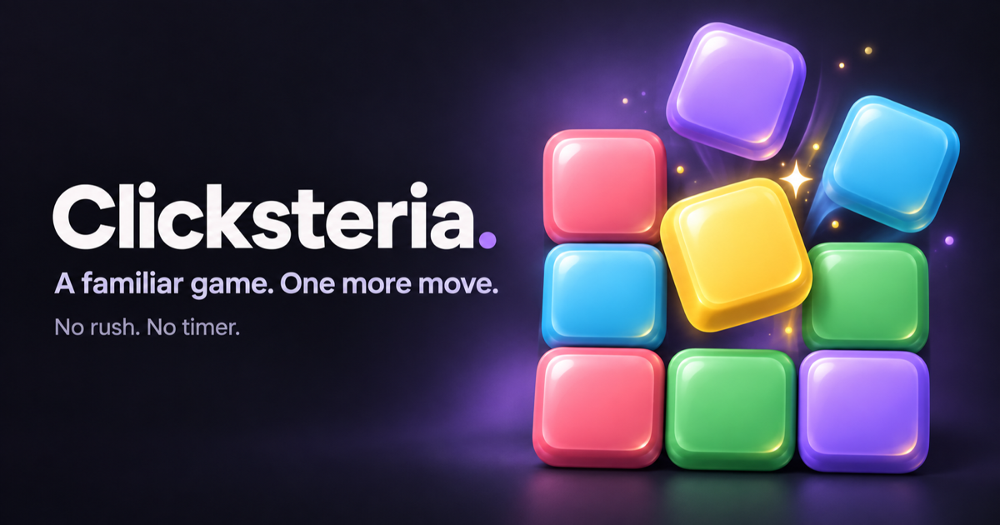

# Clicksteria



A colorful block-matching puzzle game built with Angular 22 and Tailwind CSS 4. English interface, responsive layout, SSR/prerendering, lazy routes, and no backend or external runtime services.

## Development

Use pnpm 11.19.0 (pinned in `package.json`) with Node.js 24. If using Corepack, enable it with `corepack enable pnpm`.

```sh
pnpm install --frozen-lockfile
pnpm start
pnpm test --watch=false
pnpm build
```

Open http://localhost:4200. Production output is in `dist/clicksteria`; `pnpm serve:ssr:clicksteria` runs the generated server. Tailwind is integrated through `.postcssrc.json` and `src/styles.css`.

Installing dependencies also activates the Husky pre-commit hook. It runs ESLint and Prettier only on staged files, keeping commits fast while preventing new lint and formatting issues.

## Architecture

```text
src/
  main.ts               Browser bootstrap
  main.server.ts        Angular server bootstrap
  server.ts             Express SSR server entry point
  app/
    app.routes.ts       Top-level lazy routes and route SEO data
    app.routes.server.ts
                        Prerender policy for every route
    core/
      audio/            Sound preference and lazy Web Audio playback
      services/         SEO metadata and record persistence
      theme/            System/light/dark preference and browser sync
    layout/             Persistent shell, navigation, route focus
    shared/ui/          Reusable icons and preference controls
    features/
      game/
        domain/         Immutable models and pure TypeScript rules
        data-access/    Signal store: session, history, preview, record
        ui/             Accessible board and presentational sidebar
        pages/          Feature composition and browser initialization
        game.routes.ts  Lazy game route and SEO metadata
      rules/            Lazy rules page
      settings/         Lazy appearance settings page
      not-found/        Lazy wildcard page
```

The router lazy-loads the game route collection and the standalone rules, settings, and not-found pages. `AppShell` stays mounted around them, owns global navigation and focus restoration, and starts route-driven SEO updates. Angular prerenders all routes on the server, then hydrates them in the browser.

Inside the game feature, dependencies flow from page/UI → `GameStore` → domain engine. The domain imports no Angular APIs, keeps board transformations immutable, and accepts an injectable random function for deterministic tests. The board receives state and emits user intents; it does not own scoring, history, persistence, or sound. The sidebar is presentational.

`GameStore` is a root singleton, so the current session and undo history survive navigation between Play, Rules, and Settings. It coordinates domain operations with the app-wide record and sound services, while browser-only initialization stays in `afterNextRender` to avoid SSR and hydration mismatches. Theme, sound, and record preferences degrade to in-memory behavior when browser storage is unavailable.

New routes belong in `app.routes.ts` and should be lazy by default. Keep game-specific state and behavior under `features/game`; put truly app-wide browser concerns in `core`; keep `shared/ui` limited to reusable presentational controls.

Components use Angular 22's default change detection, standalone defaults, signal inputs/outputs, and native control flow. TypeScript and Angular template strictness are enabled. Page layout and chrome use Tailwind; scoped CSS handles the board surface and focus.

The board draws its tiles and, in Classic style, symbols on a single 2D canvas above the optimized background image. `game-board-renderer.ts` owns pixel-aligned drawing; `game-board-canvas.ts` owns device-pixel-ratio scaling, resizing, and the 180 ms falling animation. Frames are requested only for changes and while tiles are moving. Pointer hit testing follows the visible tile positions during a fall. Browser observers, media-query listeners, and pending frames are released when the board is destroyed.

### Import aliases

Aliases are defined once in the root `tsconfig.json` and inherited by the application and test configurations. Angular's build and test tooling resolves them for browser bundles, SSR, and lazy routes.

| Alias         | Directory                                                |
| ------------- | -------------------------------------------------------- |
| `@app/*`      | `src/app/*` (root components, configuration, and routes) |
| `@core/*`     | `src/app/core/*`                                         |
| `@shared/*`   | `src/app/shared/*`                                       |
| `@layout/*`   | `src/app/layout/*`                                       |
| `@features/*` | `src/app/features/*`                                     |

Use the most specific alias for imports between directories, including dynamic imports. Keep relative imports for neighboring files in the same directory, such as a test importing its subject. Import directly from the source file rather than introducing barrel files; aliases do not change the dependency direction described above.

```ts
import { SoundService } from '@core/audio/sound.service';
import { GameStore } from '@features/game/data-access/game-store';
import { Icon } from '@shared/ui/icon';
import { GameBoard } from './game-board';

const loadGameRoutes = () => import('@features/game/game.routes');
```

Path targets are relative to `tsconfig.json`, so no `baseUrl` is needed. Component template/style URLs and public asset URLs remain relative paths or web URLs; these aliases apply only to TypeScript module imports.

## Game rules

- 10 columns × 15 rows, five colors; every initial board has at least one legal move.
- Click any orthogonally connected group of at least two matching tiles.
- Remaining tiles fall down; empty columns collapse left.
- A group of `n` tiles awards `n × (n − 1)` points. Clearing the board adds 1,000.
- No remaining groups ends the game; an empty board is a win.
- Undo restores the exact prior board and score, up to the start of the current game.
- Hint highlights the largest current group, with no penalty; it does not guarantee a solution.
- A new game asks for confirmation if moves have been made and the game is still active.

The record is the highest score reached, including before undo. Only the record persists in localStorage (`clicksteria:classic:best:v1`); a reload starts a fresh game. Storage failures gracefully fall back to an in-memory record. Random board creation and storage reads run in `afterNextRender`, avoiding server/client hydration differences.

## Accessibility and verification

Classic tiles have both colors and distinct shapes; Minimal and Glass omit the visible shapes. Descriptive accessible names remain available in every style. Choose Classic for visual shape cues when colors are hard to distinguish. Tab enters/leaves the board; arrow keys move between tiles; Home/End move to the first/last column; Enter/Space plays. A single focusable ARIA grid exposes the current tile through an active descendant, keeping DOM size constant as the board changes. Focus stays on the board after removal, and moves are announced through a live region. Reduced-motion preferences disable falling animations, including when changed during play.

Unit coverage includes branching adjacency, diagonal exclusion, invalid moves, gravity, empty-column collapse, immutable snapshots, scoring, wins, blocked boards, seeded complete games, undo, hints, and session initialization.

## Appearance

Open **Settings** from the header to choose the block style and board scenery at `/settings`. Returning to Play keeps the current board, score, and undo history.

The header offers System, Light, and Dark modes. System is the default and follows OS changes without saving an override. Choosing Light or Dark persists `clicksteria.theme`; choosing System removes it. Preferences synchronize between tabs, and blocked storage falls back to an in-memory choice.

`src/index.html` applies the preference before first paint. Keep its storage key and theme-color values synchronized with `core/theme/theme.service.ts`. The service initializes browser listeners after hydration and releases them on destruction. `shared/ui/theme-switcher` owns the controls; `src/styles.css` owns the `light-dark()` semantic palette. Game tiles retain their colors in both themes.

### Block styles

The **Block style** controls in Settings offer three independent appearances:

- **Classic** (default): the original opaque, beveled blocks with shape symbols.
- **Minimal**: flat, solid-color blocks without symbols.
- **Glass**: translucent colored blocks with fine rims and glossy highlights, without symbols. The selected scenery shows through the blocks.

Styles work with every board scenery and with System, Light, or Dark app modes. The selected style is applied when returning to Play without starting a new game or changing the board, score, or undo history. Idle boards do not run an animation loop.

The preference persists under `clicksteria.block-style` and synchronizes across tabs. Choosing Classic removes the override. Storage restrictions fall back to an in-memory choice. `features/game/domain/block-style.ts` defines the catalog, `data-access/block-style.service.ts` owns browser persistence, and `ui/block-style-picker/` owns the controls. Server and initial browser rendering start with Classic; a stored preference is restored after hydration.

### Board scenery

The **Board scenery** selector in Settings defaults to **Auto**, using the player's local date and Northern Hemisphere seasons: winter (December–February), spring (March–May), summer (June–August), and autumn (September–November). Celebrations take priority over the season:

| Scenery           | Automatic dates (inclusive)                           |
| ----------------- | ----------------------------------------------------- |
| New Year          | December 27–January 7                                 |
| Valentine's Day   | February 12–15                                        |
| St. Patrick's Day | March 14–18                                           |
| April Fools' Day  | April 1                                               |
| Easter            | Friday–Monday around both Western and Orthodox Easter |
| Earth Day         | April 20–23                                           |
| Midsummer         | June 20–24                                            |
| Halloween         | October 24–November 2                                 |
| Christmas         | December 18–26                                        |

These are decorative windows rather than public-holiday definitions. Easter wins if its window overlaps Earth Day. All four seasons, nine celebrations, and the original **Classic lake** can also be selected manually without changing the board, score, history, or focus. A manual choice persists under `clicksteria.scenery` and synchronizes across tabs; returning to Auto removes the override. Storage failures keep the choice in memory.

`features/game/domain/board-scenery.ts` owns the pure calendar and catalog; `data-access/board-scenery.service.ts` owns browser initialization, persistence, and date refresh. SSR starts with the same classic lake on server and client; the local scenery is selected after hydration. Auto refreshes at local midnight and when the app regains visibility or window focus, including after sleep or a timezone change. No location permission, network calendar, or date library is needed.

The optimized decorative images in `public/images/scenery/` are static, lightweight SVG landscapes. A dark overlay keeps the empty field calm. The chosen block style controls tile opacity and symbols; selection outlines and pointer hit testing work in every style. There are no weather particles, flashing lights, or new animation loops. The PWA's existing lazy asset cache stores each background when first used.

## Sound

Block clicks (mouse, touch, or keyboard) play a short, quiet synthesized pop. The speaker button toggles game sounds; the preference is stored as `true` or `false` under `clicksteria.sound` and synchronizes across tabs. Sound is on by default.

`core/audio/sound.service.ts` owns the preference, storage, lazy Web Audio context, playback, and cleanup. The toggle only displays state and calls the service; `GameStore.play()` triggers the effect. Muting stops the current sound and cancels pending playback. Missing or blocked audio/storage never interrupts the game, and no audio is initialized during SSR or page load.

## PWA and updates

The service worker is enabled in production builds on HTTPS (or localhost). It registers after application stability, with a 30-second fallback. Test it with `pnpm build` and `NG_ALLOWED_HOSTS=localhost,127.0.0.1 pnpm serve:ssr:clicksteria`, not the default development server. The local production server listens on port 4000 unless `PORT` is set.

`core/pwa/app-update.service.ts` listens for `VERSION_READY` and displays an inline banner above the page only after the new version has downloaded. Checks run after stability, every six hours while visible and online, when returning to the app, and when connectivity returns. Failed checks are retried at the next trigger. An unrecoverable worker state displays a recovery prompt. Nothing reloads automatically: the button reloads the page to load matching shell and lazy bundles. The current game resets on reload; the stored best score remains.

The server caches content-hashed JS/CSS for a year, but requires revalidation of worker scripts, `ngsw.json`, the web manifest, HTML, and unversioned assets. Preserve these headers at the CDN/reverse proxy; do not apply a cache-everything rule to these resources. Deploy each build atomically so the manifest and its referenced assets belong to the same release.

To verify an update, serve production build A, open `/play`, and wait for the service worker to control the page. Keep that tab open, replace the served build with build B containing a source change, and return to the tab (or reconnect). The banner should appear once B is downloaded; clicking **Refresh to update** loads B. Also verify offline reload after the initial cache is populated.
